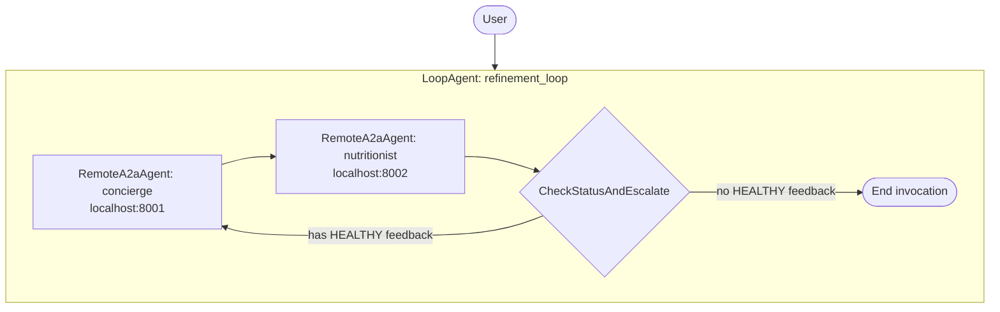

# oishii


## Design

Workflow pattern: [Iterative refinement](https://adk.dev/workflows/patterns/#iterative-refinement)



### Agents

| Agent | Type | Port | Role |
|---|---|---|---|
| concierge | LlmAgent (A2A) | 8001 | Recommends up to 5 menus for a given location; refines suggestions based on nutritionist feedback |
| nutritionist | LlmAgent (A2A) | 8002 | Reviews proposed menus against Japanese RDA and returns structured `NutritionistFeedback` |
| orchestrator | LoopAgent | — | Drives the refinement loop; escalates when no menu is rated healthy |

## How to use

1. Start agents
```shell
uv run uvicorn agents.concierge.agent:a2a_app --host localhost --port 8001
uv run uvicorn agents.nutritionist.agent:a2a_app --host localhost --port 8002
```

2. Start orchestrator
```shell
uv run adk run agents/orchestrator
```